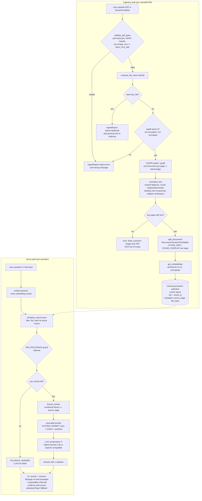

# Architecture

This document describes how the PDF RAG chatbot turns uploaded PDFs into grounded, cited answers,
which module owns each step, and why each design choice was made.

## 1. Data flow

## 2. Module responsibilities

| Module | Responsibility | Key public API |
|---|---|---|
| `rag/config.py` | All tunables from env / `.env`; validation; report snapshot; fallback sentence | `Settings`, `get_settings(**overrides)`, `FALLBACK_ANSWER` |
| `rag/pdf_loader.py` | Validate bytes (extension, header, size, encryption, corruption), extract text per page with 1-based page numbers, normalize text, detect empty / scanned pages | `validate_pdf_bytes`, `load_pdf_bytes`, `load_pdf_path`, `compute_file_hash`, `PDFValidationError`, `LoadResult` |
| `rag/chunking.py` | Split each page into overlapping chunks; add `chunk_index` and stable `chunk_id` | `split_documents(pages, chunk_size, chunk_overlap)` |
| `rag/embeddings.py` | Load and cache the local Sentence-Transformers model with normalized vectors; actionable errors on download/load failure | `get_embeddings(model_name)`, `EmbeddingInitError` |
| `rag/vectorstore.py` | Persistent Chroma collection (cosine); add/upsert chunks, list/remove files, reset corpus, filtered similarity search returning cosine similarity | `VectorStoreManager` |
| `rag/ingest.py` | Orchestrate validate -> load -> dedupe -> chunk -> index; never raises for bad PDFs | `ingest_file(...) -> IngestReport` |
| `rag/retrieval.py` | Embed the question, top-k search restricted to the active corpus, typed results | `retrieve(...) -> list[RetrievedChunk]` |
| `rag/generation.py` | Grounded system prompt, context formatting, LLM construction (Ollama / OpenAI-compatible), Ollama health check, answer generation with fallback | `SYSTEM_PROMPT`, `get_llm`, `check_ollama`, `format_context`, `generate_answer`, `LLMInitError` |
| `rag/pipeline.py` | End-to-end `ask`: retrieve -> relevance guard -> generate -> sources & abstention flag | `RAGPipeline.ask(...) -> RAGResponse` |
| `app.py` | Streamlit UI: upload & ingestion status, active-corpus selection, settings (top-k, chunk size/overlap), LLM status, chat with sources and evidence, clear corpus | — |
| `evaluation/run_eval.py` | Batch evaluation over `evaluation/questions.json`, writes JSON + Markdown records for manual grading | CLI |

## 3. Design decisions and rationale

**PyPDFLoader / pypdf for extraction.** Pure-Python, no system dependencies, gives one document per
page so every chunk can be cited with a page number. It extracts the embedded text layer only (see
limitations).

**Text normalization.** PDF text often contains hyphenated line breaks (`embed-\nding`), typographic
ligatures from LaTeX (`fi`, `fl`), stray null bytes and irregular whitespace / blank lines. Ligatures are
expanded because the embedding tokenizer otherwise splits words such as `efficient`. Hyphenated breaks
are re-joined unless the page itself uses the hyphenated form or the first part is capitalised/numeric,
so real compounds (`self-attention`, `English-to-German`) survive. Normalizing before chunking improves both embedding quality and how readable the quoted
evidence is in the UI.

**RecursiveCharacterTextSplitter, 1000 characters / 200 overlap (default).** The splitter prefers
paragraph, then line, then sentence boundaries, so chunks stay semantically coherent. About 1000
characters (~150–250 words) is large enough to hold a complete fact with its surrounding context
(e.g. a full hyper-parameter sentence or a table row with its caption), yet small enough that several
chunks fit in a small LLM's context window at top-k = 4. The 20% overlap reduces the chance that a fact
is cut in half at a chunk boundary. Chunks are produced **per page**, so each chunk maps to exactly one
page and citations stay precise; the trade-off is that a sentence spanning a page break is split.
Both values are configurable (env vars, UI, and `run_eval.py --chunk-size/--chunk-overlap`) so the
choice can be compared empirically.

**sentence-transformers/all-MiniLM-L6-v2 embeddings.** Runs locally on CPU/Apple Silicon (~90 MB,
384-dimensional), free, no API key, and is a strong general-purpose semantic-search model for its size.
Local embeddings mean document text never leaves the machine during indexing.

**Cosine similarity with normalized embeddings.** Sentence-Transformers models are trained with cosine
objectives; cosine ignores vector length and focuses on direction (meaning). The Chroma collection is
created with `hnsw:space = cosine`, and scores are reported as `1 - distance`, so higher = more similar
and values are comparable across queries — which makes the optional `MIN_RELEVANCE` threshold meaningful.

**Chroma persistent local store.** Embedded (no server to run), persists to `CHROMA_DIR` across app
restarts, supports metadata filtering, and integrates with LangChain.

**file_hash deduplication and active-corpus filter.** Every chunk carries the SHA-256 of its source
file. Re-uploading the same file (even under another name) is detected and skipped, so the index does
not fill with duplicates that would crowd out other evidence in top-k. Chunk ids are deterministic
(`<hash12>-p<page>-c<index>`), so re-adding is idempotent. At query time the search is filtered by
`file_hash IN (selected files)`, so the user controls exactly which documents can be cited and stale or
deselected documents can never leak into answers. "Clear corpus" deletes and recreates the collection.

**Top-k = 4.** Enough to cover facts that span two or three chunks while keeping the prompt short for a
3B-parameter model (long contexts dilute small models' attention and slow generation on 8 GB machines).
Adjustable in the UI and via `--top-k` for comparison.

**Grounded prompt and explicit fallback.** The system prompt instructs the model to answer only from
numbered passages, cite them as `[n]`, state which part is missing for partial answers, treat passage
text as data (prompt-injection resistance) and otherwise reply with the exact `FALLBACK_ANSWER`
sentence. If retrieval returns nothing the LLM is not called at all. Two rules were added after
evaluation (V1.1): rule 9 tells the model to prefer numbers stated in sentences over rows of flattened
table text (root cause of a wrong BLEU value), and rule 10 tells it not to justify a premise that no
passage states (root cause of a fabricated answer to a false-premise question).

**Cited sources only.** The UI's Sources line lists the file/page of the passages the answer actually
cites (`[n]` markers), not every retrieved chunk; if an answer carries no valid markers it falls back to
all retrieved pages, and abstentions show no sources. All retrieved chunks remain inspectable in the
"Retrieved evidence" panel. The response's `abstained` flag is
derived from the fallback sentence, so abstention can be measured during evaluation.

**Temperature 0.** Deterministic, least "creative" decoding minimizes hallucination and makes
evaluation runs reproducible.

**Ollama llama3.2:3b by default; any OpenAI-compatible API optionally.** The 3B model (~2 GB quantized)
runs comfortably on an 8 GB Apple-Silicon laptop, is free and private. `LLM_PROVIDER=openai` swaps in a
hosted or self-hosted OpenAI-compatible model (with `OPENAI_API_KEY` / `OPENAI_BASE_URL`) without code
changes — useful for comparing a small local model with a larger one.

**Configuration via environment.** Every tunable (chunking, top-k, models, thresholds, paths) is in
`rag/config.py` and recorded in each evaluation result, so reported results always state the exact
configuration that produced them.

## 4. Limitations

- **No OCR.** Scanned / image-only PDFs have no text layer; they are rejected with an explanatory
  message. Individual image-only pages are skipped and reported.
- **Tables, figures and equations.** Extraction flattens tables into text runs and loses figures;
  numeric answers that live only in tables may be retrieved poorly or misread. Mathematical notation is
  often garbled (e.g. sub/superscripts lost).
- **Multi-column layouts** (common in academic papers) can interleave text in extraction order.
- **Per-page chunking** splits sentences that cross a page break.
- **Small LLM quality.** A 3B model can miss facts spread over several chunks, paraphrase imprecisely,
  ignore citation instructions, or answer from prior knowledge despite the prompt. Use a larger model
  via `LLM_MODEL` / `LLM_PROVIDER=openai` when quality matters.
- **Pure dense retrieval.** No keyword/BM25 hybrid or re-ranker; exact identifiers, numbers and rare
  terms can be missed by the embedding model.
- **Single user, local.** One shared Chroma collection, no authentication, no concurrent-write
  handling; intended for local, single-user use.
- **English-centric** embedding model.
